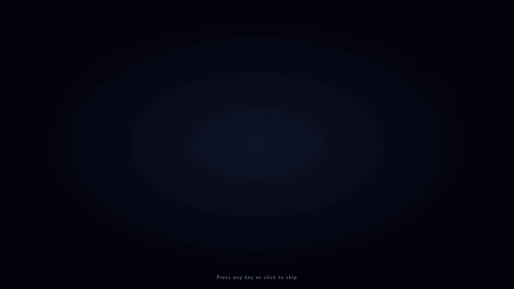
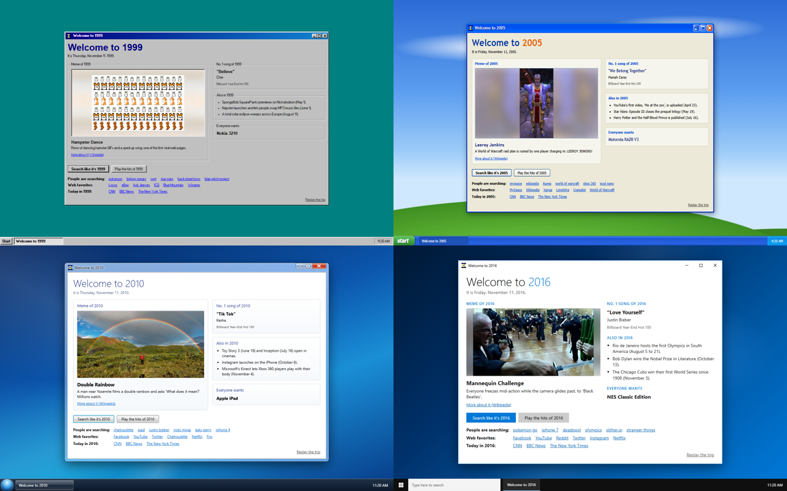
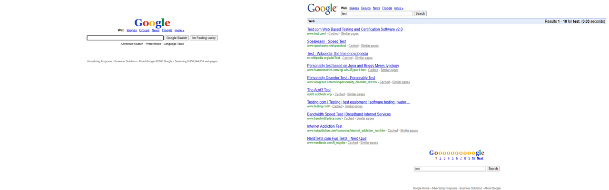
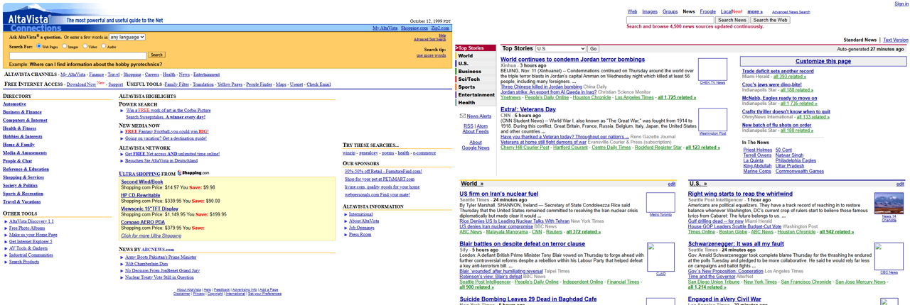
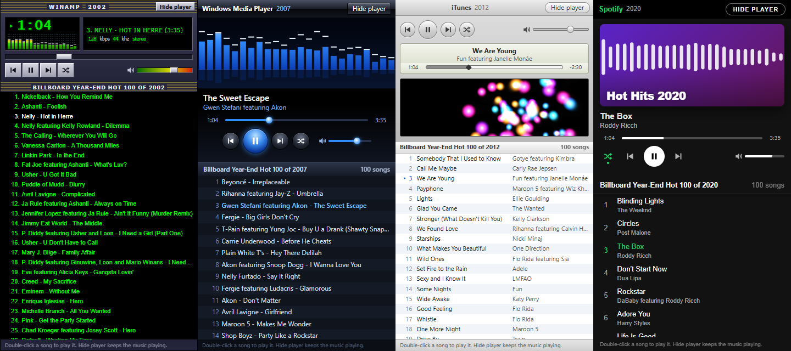
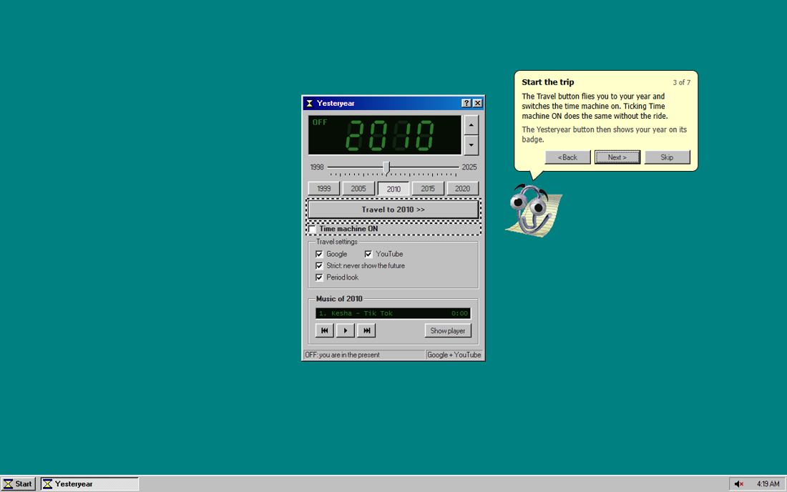
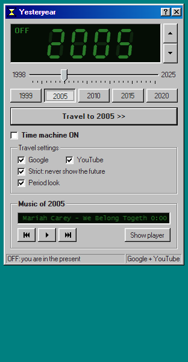

# Yesteryear: a retro time machine for your searches

**Pick a year. Google, YouTube and the whole web go back with you.**

What did the internet say about phones before the iPhone? What was on Google News on this day in 2005?
What was everyone googling in 2004? Set the dial to any year from **1998 to 2025**, hit **Travel**, and search
the way people did back then.

- 🕰️ **Google as it looked that year**, with that year's logo and layout.
- 🚫 **No spoilers from the future.** Results, pages and videos stop at your year.
- 🌐 **Every link opens the web as it was**, straight from the Internet Archive.
- 🎵 **The soundtrack of the year** plays while you browse.
- 📎 **Clippy** shows you around.

> Free and open source Chrome extension. A hobby project: not affiliated with Google, YouTube, Microsoft or the
> Internet Archive.

**[Download the latest version](../../releases/latest)** · [How to install](#install)

---

## 🚀 The trip

**Travel to 2005 >>** is not a setting, it's a ride: a time tunnel, a date display rolling back from today, a flash,
and you land on the card of your year. It is dressed like a computer of that time (Windows 98, XP, 7 or 10) and
tells you what the world looks like today, in that year:

- the **meme** everyone is sharing and the **No. 1 song** on the radio;
- what has **already happened** that year, and the **gadget** everyone wants;
- what **people are searching for**: one click and you google it like it's that year;
- the **sites everyone visits** (GeoCities, Napster, MySpace...), opened as they looked that very day;
- **today's front pages** of CNN, BBC News and The New York Times, from that date.

The card never spoils anything: early in the year it still shows last year's meme, because this year's has not
happened yet.

## 🔎 Google, exactly as it was

Eleven period looks, from the 1998 "Google!" beta to today. And it is not just a skin: your search really goes back.

- "best phones **this year**" becomes "best phones 2005", and Google's own date filter stops at your year.
- Results that give away a later date or mention things that did not exist yet are dropped.
- Sites that were not online yet are left out.
- Search for something from the future and Google tells you: *"2009 has not happened yet. It is 2005."*
- **I'm Feeling Lucky** works like it used to. With an empty box it shows Google's holiday logos of the time.

## 🌐 The web of that very day

Click a result and it opens from the Internet Archive as it looked in your year, never later. If that exact page
was never saved, you get the site's front page from back then, with a note in the style of the old browser.

Google's own tabs work too: **News, Groups, Gmail and "more"** open those services as they were on today's date
in your year. On the 1999 results page, "Try your query on" takes you to **AltaVista, Excite, Lycos and Yahoo!**
of 1999.

## 📺 YouTube before it got big

Searches only bring up videos uploaded by your year. Shorts, ads and the modern clutter are gone. Travel to 2003
and YouTube simply doesn't exist yet.

## 🎵 The soundtrack of the year

The Billboard Year-End Hot 100 of your year, in the player of the time: Winamp, Windows Media Player, iTunes or
Spotify. A mini player sits right in the extension's window; hide the big player and the music keeps going.

## 📎 Clippy shows you around

On first start, Clippy (or Rover, if you are a dog person) walks you through every button, one by one.

---

## Things to try

1. Travel to **1999** and press **I'm Feeling Lucky** with an empty box.
2. In **2010**, google *music trends this year*.
3. On the **2005** Google homepage, click **News**: that's Google News on today's date in 2005.
4. On a **1999** results page, scroll down and visit AltaVista or Yahoo! of 1999.
5. Travel to the year you got your first computer and open one of its **Web favorites**.
6. Press **Play the hits of 2002**: they come in Winamp.

## Install

1. Download `yesteryear-<version>.zip` from [Releases](../../releases/latest) and unzip it.
2. Open `chrome://extensions` and switch on **Developer mode** (top right).
3. Click **Load unpacked** and choose the `extension` folder. Clippy appears in a new tab.
4. Pin Yesteryear (puzzle icon, then the pin), click it, pick a year and press **Travel to YEAR >>**.

Tip: use a separate Chrome profile. While the time machine is ON, every Google search in that profile travels.

**Updating:** replace the folder with the new version, then click the round reload arrow on the Yesteryear card in
`chrome://extensions` and reload open Google and YouTube tabs.

## Good to know

- Google decides dates by its own estimate, so a modern page can slip through now and then.
- Archived pages load at the Internet Archive's speed, and some old pictures were never saved.
- The music comes from YouTube. If YouTube refuses to play, open youtube.com once in that Chrome profile, then
  press Play again.
- It is not in the Chrome Web Store: the hidden music player and Clippy would not pass its rules. Clippy and Rover
  belong to Microsoft (as shared by clippy.js for years) and are here just for fun.
- Archived sign-in pages (Gmail and others) are read-only. Never type a real password into an archived page.

---

## Develop
- Architecture and contracts: `ARCHITECTURE.md`; research behind every decision: `research/`.
- Unit tests (no network), in Git Bash: `node --test "tests/*/*.test.mjs"`
- Live checks in throwaway Chromium profiles, in Git Bash after `export PYTHONIOENCODING=utf-8 MSYS_NO_PATHCONV=1`.
  None of them sends anything to Google (they use archive.org, Wikimedia images and one YouTube embed load):
  - popup: `.venv/Scripts/python.exe tests/ui/popup_check.py`
  - tour: `.venv/Scripts/python.exe tests/tour/shots.py all` and `.venv/Scripts/python.exe tests/tour/behavior.py`
  - travel: `.venv/Scripts/python.exe tests/travel/visual_check.py`
  - music: `(cd tests/player && ../../.venv/Scripts/python.exe live_offscreen.py)`; headless YouTube may show a
    bot check, then 2 checks fail (the test browser, not the extension)
  - Google on saved pages: `.venv/Scripts/python.exe tests/live/render_fixture.py 2020_linux.html 2001`,
    `.venv/Scripts/python.exe tests/live/services_check.py 2005 News`, `.venv/Scripts/python.exe tests/live/resolver_check.py`,
    `.venv/Scripts/python.exe tests/live/lucky_check.py 2005`
  - fully stubbed, no network: `.venv/Scripts/python.exe tests/live/core_check.py` (core fixes; `--src=<dir>` checks
    another export) and `.venv/Scripts/python.exe tests/player/popup_width.py` (mini player width for every year)
- `tests/live/smoke.py` does real Google and YouTube searches: don't run it from automation.

## License
- Yesteryear's own code: MIT (see `LICENSE`).
- `extension/src/vendor/98css/`: 98.css 0.1.21 (MIT) and the Pixelated MS Sans Serif font (CC BY-SA 3.0), see the
  files in that folder.
- `extension/src/vendor/clippy/`: data of clippyjs 0.1.0 (MIT); the Clippy and Rover characters, pictures and sounds
  belong to Microsoft.
- Year cards: meme pictures are loaded from Wikimedia (each under its own license, linked on the card); the music
  lists are the Billboard Year-End Hot 100 (titles and artists only); songs play from YouTube.
